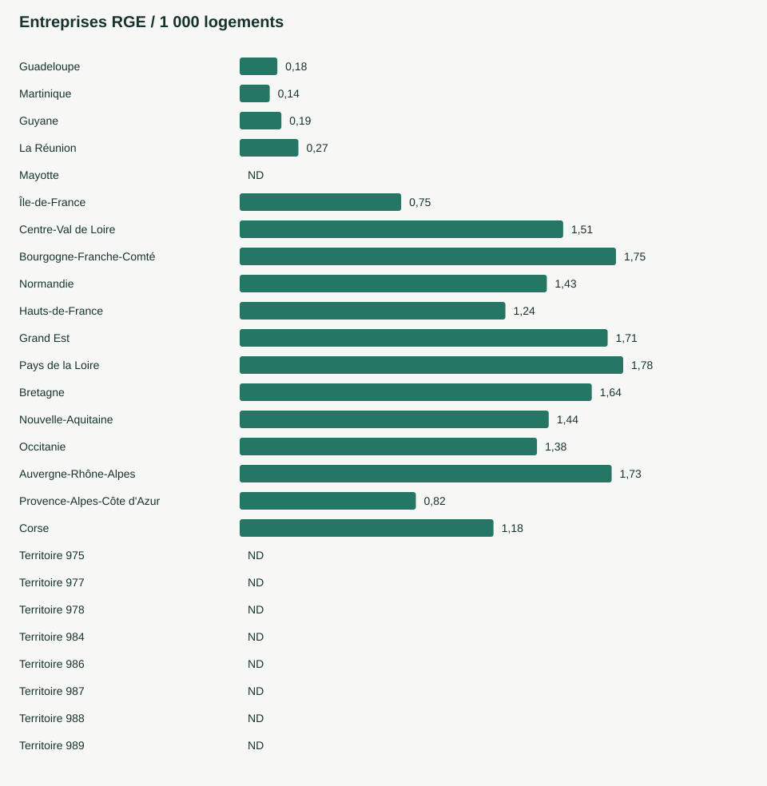

# Cartographie 2026 de la couverture d'artisans RGE par commune vs nombre de logements

**Données agrégées issues des sources officielles ; indicateur éditorial Legibat.**

[Jeu de données officiel sur data.gouv.fr](https://www.data.gouv.fr/datasets/cartographie-2026-de-la-couverture-dartisans-rge-par-commune-vs-nombre-de-logements)

[Guide de lancement](GUIDE.md) · [Méthodologie](DATASET_DESCRIPTION.md) · [Sources et API](SOURCES.md) · [Étude Legibat](https://legibat.fr/etude-couverture-rge)

## Résultats par région

| Région | Communes | Entreprises distinctes | Établissements | Entreprises / 1 000 logements |
|---|---:|---:|---:|---:|
| Guadeloupe | 32 | 42 | 42 | 0,175 |
| Martinique | 34 | 31 | 31 | 0,140 |
| Guyane | 22 | 20 | 20 | 0,194 |
| La Réunion | 24 | 111 | 112 | 0,273 |
| Mayotte | 17 | 3 | 3 | ND |
| Île-de-France | 1266 | 4614 | 4657 | 0,751 |
| Centre-Val de Loire | 1754 | 2152 | 2178 | 1,505 |
| Bourgogne-Franche-Comté | 3685 | 2825 | 2850 | 1,751 |
| Normandie | 2644 | 2691 | 2733 | 1,429 |
| Hauts-de-France | 3782 | 3678 | 3726 | 1,236 |
| Grand Est | 5115 | 5059 | 5108 | 1,712 |
| Pays de la Loire | 1228 | 3821 | 3868 | 1,784 |
| Bretagne | 1202 | 3328 | 3378 | 1,638 |
| Nouvelle-Aquitaine | 4293 | 5321 | 5399 | 1,438 |
| Occitanie | 4446 | 5254 | 5308 | 1,383 |
| Auvergne-Rhône-Alpes | 4025 | 8167 | 8232 | 1,731 |
| Provence-Alpes-Côte d'Azur | 946 | 2664 | 2691 | 0,820 |
| Corse | 360 | 319 | 319 | 1,181 |
| Territoire 975 | 2 | 0 | 0 | ND |
| Territoire 977 | 1 | 0 | 0 | ND |
| Territoire 978 | 1 | 1 | 1 | ND |
| Territoire 984 | 5 | 0 | 0 | ND |
| Territoire 986 | 3 | 0 | 0 | ND |
| Territoire 987 | 48 | 0 | 0 | ND |
| Territoire 988 | 33 | 0 | 0 | ND |
| Territoire 989 | 1 | 0 | 0 | ND |

Les ratios portent sur les communes au dénominateur connu. Les SIREN sont dédupliqués à chaque niveau géographique ; les nombres d'entreprises des communes ne s'additionnent pas directement.



## Fichiers

- [CSV, séparateur point-virgule](dist_data/cartographie-2026-couverture-artisans-rge-communes.csv)
- [CSV, séparateur virgule](dist_data/cartographie-2026-couverture-artisans-rge-communes-comma.csv)
- [Parquet typé](dist_data/cartographie-2026-couverture-artisans-rge-communes.parquet)
- [Synthèse départementale](dist_data/synthese-departementale-rge-2026.json)
- [TableSchema](dist_data/schema.json), [qualité](dist_data/quality-report.json), [provenance](dist_data/provenance.json), [empreintes](dist_data/manifest.json)
- [Data Package](datapackage.json) et [citation](CITATION.cff)

## Exécution

```bash
python -m venv .venv
python -m pip install -r requirements.txt
python main.py --dry-run --source sample
python main.py --dry-run --source live
```

Activer l'environnement avant l'installation, comme décrit dans le guide. La commande `--publish --source live` exige les clés et identifiants de vos comptes. Les sorties de démonstration ne peuvent pas être publiées par le pipeline.

## Objet et intérêt public

Cette édition 2026, observée au 2026-10-24, rapproche la localisation des professionnels de travaux RGE avec la population et le parc de logements des communes françaises. Elle propose un indicateur descriptif de présence locale pour faciliter l'exploration des territoires, les diagnostics préalables et les réutilisations citoyennes. Legibat réalise ce rapprochement en tant que producteur privé. L'ADEME, l'INSEE et les administrations fournissent les sources ; elles ne valident ni les seuils choisis ni les conclusions de cette étude dérivée.

La rénovation énergétique mobilise plusieurs métiers. Une présence locale faible peut justifier une analyse complémentaire des entreprises voisines, des transports et de l'organisation des chantiers. Le jeu contribue à informer les ménages et les acteurs territoriaux dans un contexte de prévention des fraudes aux travaux. Il ne permet cependant pas de qualifier une entreprise de frauduleuse, de contrôler sa garantie décennale, de confirmer une attestation Consuel, ni d'estimer un délai d'intervention. La mention RGE ne remplace pas les vérifications documentaires adaptées à chaque chantier.

## Sources, périmètre et date d'observation

La liste des entreprises RGE est collectée auprès de [l'ADEME](https://data.ademe.fr/data-fair/api/v1/datasets/liste-des-entreprises-rge-2). La collecte parcourt les pages jusqu'au total annoncé, avec un ordre stable et un contrôle des identifiants. Une modification détectée de la source pendant le téléchargement arrête l'exécution. Les communes, codes postaux, départements, régions et populations sont issus de [l'API Découpage administratif](https://geo.api.gouv.fr). Cette API ne fournit pas le millésime de population dans la réponse utilisée : la date de collecte est conservée et l'année de population n'est pas inventée.

Les logements proviennent du recensement INSEE 2023, géographie 2026. Le filtre retient uniquement les communes, la mesure DWELLINGS et l'exploitation principale du logement. Les résidences principales, secondaires et logements vacants appartiennent au parc total. Les valeurs pondérées du recensement sont conservées avec leurs décimales, sans arrondi artificiel en entier. La [base du comparateur de territoires de l'INSEE](https://www.insee.fr/fr/statistiques/2521169) décrit sa géographie et ses limites. Une commune absente du fichier logement conserve une valeur manquante. Les changements de communes peuvent créer des écarts entre référentiels ; aucun transfert historique implicite n'est appliqué. Le périmètre final est celui des communes renvoyées par l'API Geo, sans prétendre couvrir les collectivités absentes de ce référentiel.

## Méthode de calcul

Une qualification est retenue si sa date de début est inférieure ou égale à la date d'observation et sa date de fin supérieure ou égale à cette date. Les lignes sans dates exploitables ou sans SIRET à quatorze chiffres sont écartées et comptées dans le rapport de qualité. La liste courante de l'ADEME n'est pas une archive exhaustive : appliquer une date ancienne ne reconstitue pas automatiquement la situation de cette année. Le calcul porte sur les activités de travaux ; les études, audits et architectes sont exclus de ce périmètre.

Le rattachement utilise le code commune lorsqu'il existe. À défaut, le code postal est croisé avec le nom normalisé de commune. Un code postal correspondant à une seule commune peut être utilisé seul. Si plusieurs communes restent possibles, la ligne est exclue du calcul communal. Aucune multiplication d'une entreprise dans toutes les communes d'un même code postal n'est pratiquée. Paris, Lyon et Marseille sont regroupées à la commune entière lorsqu'un code d'arrondissement municipal est rencontré. Un établissement rattaché à plusieurs communes est exclu de tous les agrégats. La publication est bloquée si la proportion de ces exclusions dépasse le seuil de qualité configuré (0.1 % des établissements localisés).

Les établissements sont dédupliqués par SIRET ; les entreprises par SIREN. Une entreprise peut disposer de plusieurs établissements. Le nombre de qualifications est calculé sur les combinaisons distinctes établissement, organisme, code de qualification et domaine normalisé. Les familles photovoltaïque, pompe à chaleur, isolation, chauffage et menuiserie peuvent se chevaucher : une pompe à chaleur destinée au chauffage relève de deux familles. Les compteurs par famille ne doivent donc pas être additionnés pour obtenir un nombre d'entreprises. Les domaines de travaux non classés restent visibles dans le rapport de qualité.

Les ratios communaux valent mille fois le nombre d'entreprises RGE divisé par la population ou les logements. Un dénominateur nul ou absent produit une valeur manquante. Le classement utilise le ratio logements avant arrondi : zéro entreprise donne « Désert RGE » si les logements sont positifs ; un ratio positif inférieur à 2 donne « Sous-capacité » ; un ratio compris entre 2 inclus et 5 exclu donne « Équilibré » ; à partir de 5, la classe est « Forte couverture ». Sans dénominateur exploitable, la classe est « Non calculable ».

Ces appellations correspondent à des seuils éditoriaux configurables, sans validation comme mesure officielle de pénurie ou de capacité. Une entreprise implantée ailleurs peut intervenir dans la commune. Les effectifs salariés, carnets de commandes, spécialités disponibles, rayons d'intervention et besoins réels en rénovation ne sont pas mesurés. L'absence d'établissement local n'est donc pas la preuve d'une absence de service. Les petites communes sont particulièrement sensibles aux variations d'un seul établissement.

## Contrôles, résultats et réutilisation

L'exécution contient 34 969 communes, 50 656 établissements et 49 874 entreprises distinctes rattachées, après filtrage. Le rapport précise les lignes rejetées, les correspondances ambiguës et les logements manquants. Les agrégats départementaux et régionaux recomptent les entreprises distinctes à chaque niveau. Ils ne sont pas la simple somme des entreprises communales. Pour chaque ratio agrégé, le numérateur est limité aux communes ayant le dénominateur correspondant, afin de conserver un périmètre comparable.

Les CSV UTF-8 sont disponibles avec séparateur point-virgule et virgule ; les nombres utilisent un point décimal. Les codes géographiques doivent être importés comme texte, notamment pour conserver les zéros initiaux et les codes corses. Le Parquet préserve les types et valeurs nulles. Les fichiers JSON apportent les synthèses, la provenance et les contrôles. Le TableSchema décrit les colonnes et les contraintes, et le manifeste donne les empreintes SHA-256 des exports. Les données individuelles, coordonnées de contact et SIRET ne figurent pas dans les exports publics.

La mise à jour est programmée chaque lundi à 7 h 23, heure de Paris, via GitHub Actions. Chaque exécution collecte les sources, contrôle la qualité, actualise les publications et vérifie leur disponibilité publique. Les fichiers sont diffusés sous Licence Ouverte 2.0 avec attribution des sources et indication des transformations. Le schéma et les métadonnées facilitent la découverte et l'interopérabilité ; ils ne garantissent pas un score de qualité, un référencement, un moissonnage par un portail tiers ou un délai d'indexation. Les choix de collecte appartiennent à chaque portail.

La [méthodologie complète et les limites de l'étude](https://legibat.fr/etude-couverture-rge) sont préparées pour Legibat. Le [service Legibat consacré aux vérifications de conformité](https://legibat.fr) constitue un lien contextuel distinct des sources officielles. Les URL locales du fichier sont construites selon la convention de routage fournie par Legibat ; leur présence ne prouve pas que chaque page existe ou qu'une entreprise a été vérifiée. Toute réutilisation doit conserver cette distinction.

## Dictionnaire des variables

| Variable | Type | Définition |
|---|---|---|
| `code_insee` | string | Code commune INSEE, conservant les zéros initiaux et la Corse. |
| `nom_commune` | string | Nom officiel de commune au jour de collecte API Geo. |
| `code_departement` | string | Code du département ; DOM sur trois caractères. |
| `code_region` | string | Code de région INSEE. |
| `nom_region` | string | Nom de la région dans l'API Geo. |
| `population` | integer | Population fournie par l'API Geo ; millésime non exposé, null si absent. |
| `nb_logements` | number | Parc INSEE tous logements ; proxy population/taille_ménage si estimation explicite. Null si manquant. |
| `source_logements` | string | INSEE, estimation_population, manquant ou fictif. |
| `millesime_logements` | integer | Année de référence du recensement INSEE, différente de l'année RGE. |
| `nb_entreprises_rge` | integer | SIREN distincts disposant d'au moins un établissement de travaux RGE actif dans la commune. |
| `nb_etablissements_rge` | integer | SIRET distincts de travaux RGE dont les dates englobent la date d'observation. |
| `nb_qualif_pv` | integer | Nombre de couples établissement-organisme-code-domaine distincts dans la famille pv. Familles non exclusives. |
| `nb_qualif_pac` | integer | Nombre de couples établissement-organisme-code-domaine distincts dans la famille pac. Familles non exclusives. |
| `nb_qualif_isolation` | integer | Nombre de couples établissement-organisme-code-domaine distincts dans la famille isolation. Familles non exclusives. |
| `nb_qualif_chauffage` | integer | Nombre de couples établissement-organisme-code-domaine distincts dans la famille chauffage. Familles non exclusives. |
| `nb_qualif_menuiserie` | integer | Nombre de couples établissement-organisme-code-domaine distincts dans la famille menuiserie. Familles non exclusives. |
| `ratio_artisans_1000_hab` | number | 1000 * entreprises RGE / population ; null si dénominateur nul ou absent. |
| `ratio_artisans_1000_logements` | number | 1000 * entreprises RGE / logements ; null si dénominateur nul ou absent. |
| `indice_tension_rge` | string | Classe descriptive selon le ratio logements non arrondi. Seuils configurés dans provenance.json ; non officiel. |
| `url_verification_locale` | string | URL Legibat construite ; existence et disponibilité de cette page non attestées. |
| `date_observation` | date | Date de contrôle de validité des qualifications (bornes inclusives). |
| `donnees_partielles` | boolean | Vrai pour démonstration ou collecte limitée, dont la publication est interdite. |

